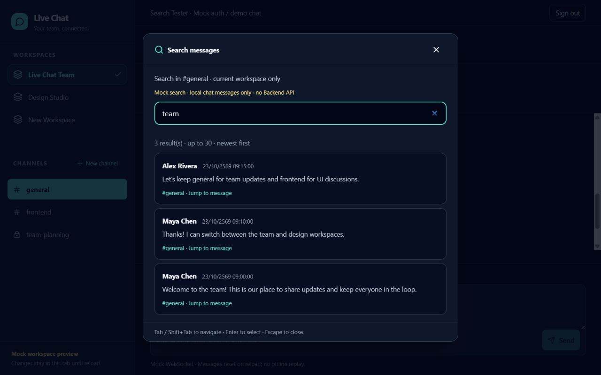
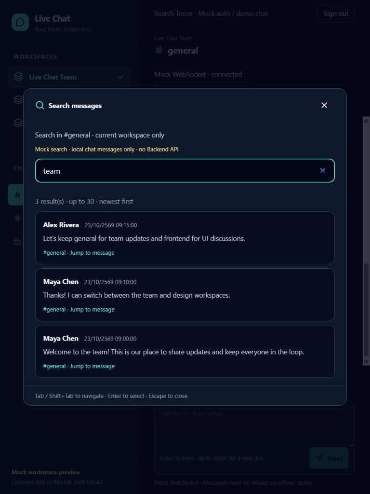
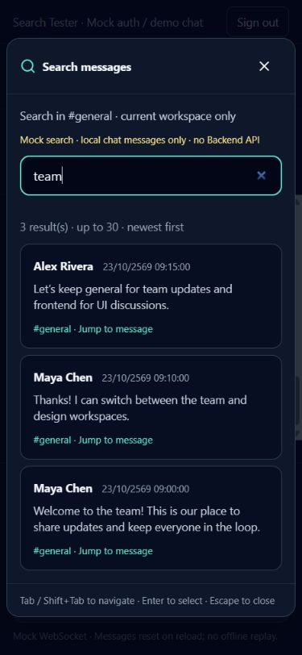

# Frontend Issue #7 — Search UI

ตรวจวันที่ 23 ตุลาคม 2026 บน branch `feat/7-search-ui`; ก่อนเริ่ม Working Tree สะอาด
แก้เฉพาะ `livechat-frontend`; Backend อยู่ `main` และไม่มีการเปลี่ยนไฟล์
ไม่มี Commit, Push หรือ PR

## ข้อกำหนดและ API contract

อ่าน README, `plan/team_issue_specifications.md`, `plan/project_build_roadmap.md` และ
`plan/master_architecture_blueprint.md` ของทั้งสอง repo แล้ว แผน Markdown ของทั้งสอง repo มี SHA256 ตรงกัน
ตรวจ Sidebar, workspace/channel selection, ChatArea, MessageItem, Auth และ WebSocket provider/transport เดิม

- Frontend #7: Ctrl+K เปิด Modal, `GET /api/v1/channels/{id}/search?q={query}` และคลิกผลเพื่อไปยังข้อความ
- Backend #9 / Blueprint: กรอง `channel_id`, PostgreSQL English full-text, เรียง `ts_rank` และจำกัด 30
- ขอบเขตเป็น Channel ปัจจุบันใน Workspace ที่เลือก ไม่รวมผลข้าม Channel หรือ Workspace
- Backend checkout ยังไม่มี `app/`, endpoint, response schema หรือ API สำหรับโหลดประวัติรอบข้อความ

`createApiSearchService(api, decode)` เตรียม URL relative กับ authenticated Axios client
(`authService.api`, base URL `/api/v1`) พร้อม query params และ AbortSignal
ไม่สมมติว่า response เป็น array หรือ `{ results: ... }`: ผู้เชื่อมต้องส่ง decoder ที่ตรวจข้อมูลจริง
adapter ป้องกัน workspace/channel ไม่ตรงกันและผลที่มี channel_id ผิด พร้อมคงลำดับ relevance จาก Backend
ยังไม่เรียก adapter นี้จากหน้าจอ เพื่อไม่ส่ง mock IDs หรือแอบ fallback ไป Mock หลัง API ล้มเหลว

## พฤติกรรม

- ปุ่ม Search messages, Ctrl+K / Cmd+K; ไม่เปิดซ้อน mobile navigation dialog
- Native modal dialog, ชื่อ/คำอธิบายสำหรับ assistive technology, focus ช่องค้นหาตอนเปิด
- Debounce 250ms; ยกเลิกคำขอเมื่อเปลี่ยนคำค้น ล้างคำค้น ปิด หรือเปลี่ยนห้อง/ออกจากระบบ
- ไม่รับ late result/error ของคำขอที่ยกเลิก และล้างผลเก่าระหว่างค้นหา
- Loading, Empty, Error พร้อม Retry; whitespace ไม่ค้นหา
- แสดงผู้ส่ง ข้อความแบบ plain text, Channel, วันเวลาใน timezone/locale ของ Browser
- Tab/Shift+Tab วนใน Modal; Enter/Space เลือกผล; Escape ครั้งเดียวปิดแม้ช่อง search มีข้อความ
- ปิดแล้วคืน focus จุดเดิม; เลือกผลแล้วเลื่อนและ focus ข้อความพร้อม highlight
- Chat draft ไม่ถูกล้างเมื่อเปิด/ปิด Search
- ผลค้นหา scroll แยกจากส่วนหัว/ช่องค้นหา/คำแนะนำ และขนาด Modal จำกัดตาม viewport

## Mock และวิธีตรวจ

```powershell
$env:VITE_AUTH_MODE = 'mock'
$env:VITE_WS_MODE = 'mock'
$env:VITE_SEARCH_MODE = 'mock'
npm run dev
```

Register บัญชีทดสอบแล้ว Login; กด Search messages หรือ Ctrl+K และค้น `team` ใน general
Mock service ใช้ข้อความจาก active WebSocket mock snapshot รวมข้อความใหม่ที่ส่งและรับ
ไม่สร้างประวัติชุดที่สอง จึงเลือกผลแล้วไปยังข้อความจริงในแชตได้
จำลอง latency 300ms; trim + case-insensitive substring matching, สูงสุด 30 ผล เรียงใหม่ก่อน
รองรับข้อความภาษาไทยและ special characters แบบ literal
ป้าย Mock ชัดเจน; ไม่มี HTTP Search request หรือข้อมูลคงอยู่หลัง reload
ต้องเปิดทั้ง Search Mock และ WebSocket Mock; โหมดอื่น/production แสดง unavailable/integration pending
production ไม่รวม mock search adapter

1. ค้น `team`, ลองข้อความที่ไม่มีผล, ล้างช่อง และพิมพ์เปลี่ยนคำเร็ว ๆ
2. ส่งข้อความไทยใน chat แล้วค้นข้อความนั้น รวมข้อความจาก Receive mock message
3. เลือกผลด้วย Enter หรือคลิก ตรวจ focus/highlight และตำแหน่งประวัติ
4. ตรวจ Tab/Shift+Tab ที่ขอบแรก/สุดท้าย และ Escape เมื่อช่องมีข้อความ
5. สลับ frontend และ Design Studio ตรวจว่าไม่พบข้อความจาก general
6. ตรวจ 375×812, 768×1024 และ 1280×800 รวม Sidebar, composer และการเลื่อนผล

## ไฟล์สร้างใหม่

| ไฟล์ | หน้าที่ |
|---|---|
| `src/types/search.ts` | UI request และ service interface |
| `src/services/searchService.ts` | Future API adapter พร้อม injected decoder |
| `src/services/mockSearchService.ts` | ค้นจาก active mock chat history |
| `src/components/SearchMessages.tsx` | ปุ่มเปิด, shortcut, เลือก service และวงจร Modal |
| `src/components/SearchModal.tsx` | Search UI, async state, keyboard/focus และผลค้นหา |
| `tests/search.test.mjs` | Service tests 8 เคส |
| `tests/search-modal.test.mjs` | Modal tests 5 เคส |
| `docs/frontend-issue-7.md` | รายงานฉบับนี้ |
| `docs/issue-7/search-desktop.png` | หลักฐานหน้าจอ 1280px |
| `docs/issue-7/search-tablet.png` | หลักฐานหน้าจอ 768px |
| `docs/issue-7/search-mobile.png` | หลักฐานหน้าจอ 375px |

## ไฟล์แก้ไข

| ไฟล์ | การเปลี่ยนแปลง |
|---|---|
| `src/components/LiveChat.tsx` | วาง Search และส่ง jump target ให้ ChatArea |
| `src/components/ChatArea.tsx` | เลื่อนและ focus ผลที่เลือก โดยคง flow ส่ง/รับเดิม |
| `src/components/MessageItem.tsx` | Message target identifier และ highlight/focus style |
| `.env.example` | `VITE_SEARCH_MODE` ค่าเริ่มต้น api ที่ยัง gated |
| `package.json`, `package-lock.json` | `test:search` และ JSDOM 27 dev dependency สำหรับ UI tests |
| `README.md` | วิธีเปิด Mock, ทดสอบ และข้อจำกัด Backend |

## ผลทดสอบ

- `npm ci`: ผ่านหลังหยุด frontend Vite ที่ล็อก esbuild.exe; ติดตั้งตาม lockfile ใหม่
- `npx tsc --noEmit`: ผ่าน
- `npm run lint`: ผ่าน ไม่มี warnings
- `npm run build`: ผ่าน
- `npm test`: 40/40 (Auth 10, WebSocket 17, Search Service 8, Search Modal 5)
- `npm run test:search`: 13/13
- UI automated: debounce/loading, result metadata/plain text, empty, whitespace, error/retry,
  cancel/late results, unmount, disabled mode, focus และ keyboard handlers
- JSDOM จำลอง showModal/close สำหรับ lifecycle; ตรวจ native focus trap, Escape และ layout ใน Browser แยก
- Browser: Register → Login ด้วย Enter, ค้นหา, sent/received Thai messages, plain text,
  Ctrl+K, Tab/Shift+Tab wrap, Escape, focus restoration, เลือกผลแล้ว focus ข้อความ,
  Channel/Workspace isolation และ mobile drawer ไม่ซ้อน Search ผ่าน
- Regression Browser: draft คงอยู่, ส่งข้อความ, typing, receive, disconnect/reconnect และ Sign out ผ่าน
- Responsive: 375/768/1280px ไม่มี horizontal overflow; ภาพประกอบด้านล่าง
- Browser Console: ไม่พบ warning/error ใน flow ที่ตรวจ
- Git diff: ตรวจ scope และ whitespace แล้ว; Backend ไม่เปลี่ยนแปลง

## ข้อจำกัด

- ยังไม่ยืนยัน integration กับ Backend, JWT จริง หรือ server authorization; UI scope guard ไม่แทน server access checks
- ต้องตกลง response envelope/author schema, validation/error format และใช้ workspace/channel IDs จริงก่อนเปิด API mode
- Backend ต้องกำหนดวิธีโหลด historical message ที่ยังไม่อยู่ใน Client ก่อนรองรับ jump สำหรับผลจาก API จริง
- Mock ค้นได้เฉพาะข้อความใน memory ของแชต ไม่ใช่ประวัติทั้งฐานข้อมูล, ไม่มี pagination และไม่จำลอง ts_rank/stemming
- ทดสอบ responsive ผ่าน Browser viewport; ยังไม่ได้ทดสอบบนอุปกรณ์จริงหรือ mobile virtual keyboard
- npm รายงาน dependency advisories 7 รายการ (2 moderate, 5 high) ตั้งแต่ `npm ci` ก่อนเพิ่ม JSDOM และยังเท่าเดิม;
  ไม่อัปเกรด dependencies ของ Issue ก่อนหน้านอกขอบเขต Search

## ภาพหน้าจอ




