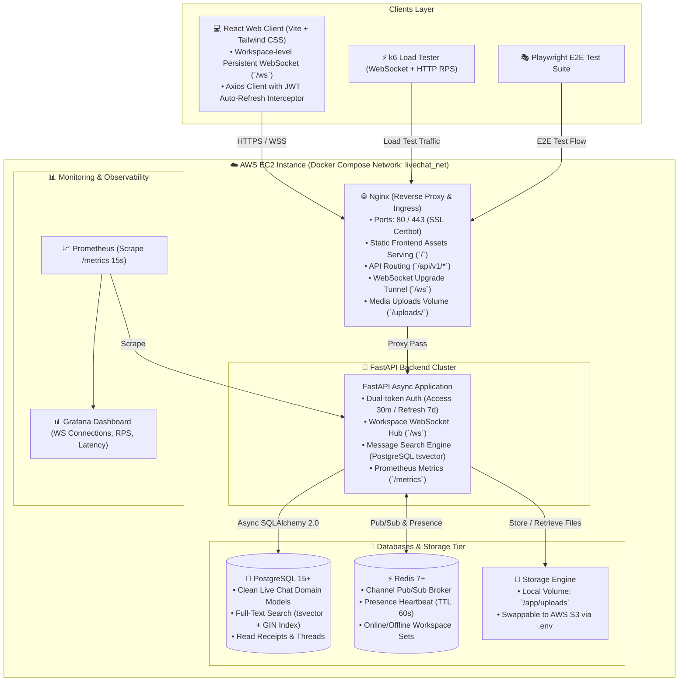

# Master Architecture Blueprint: Real-Time Live Chat Platform
> **Repository Strategy:** Clean Monorepo (`backend/` + `frontend/`)  
> **Deployment Target:** AWS EC2 + Docker Compose + Nginx + Let's Encrypt  
> **Team Collaboration Focus:** Modular component-based development without merge conflicts

---

## 1. System Architecture Overview



---

## 2. Directory Structure for the New Repository

```text
livechat-workspace/
├── .github/
│   └── workflows/
│       ├── ci.yml               # Lint + Pytest (with Postgres/Redis services) + React Test
│       └── cd.yml               # Docker build -> GHCR push -> SSH deploy to AWS EC2
├── backend/
│   ├── alembic/                 # Database migrations (clean livechat domain)
│   ├── app/
│   │   ├── config/              # Settings (pydantic-settings), metrics, security
│   │   ├── controllers/         # REST Controllers & WebSocket endpoint (/ws)
│   │   ├── db/                  # Async engine & sessionmaker (SQLAlchemy 2.0)
│   │   ├── models/              # Pure domain models (User, Workspace, Channel, Message, etc.)
│   │   ├── schemas/             # Pydantic v2 schemas & search queries
│   │   ├── services/            # Business logic (Auth, ChatPubSub, SearchService, Presence)
│   │   └── main.py              # FastAPI application factory & router mounting
│   ├── tests/
│   │   ├── conftest.py          # Async test fixtures (database, redis, auth clients)
│   │   ├── test_auth.py
│   │   ├── test_chat_search.py  # Tests for tsvector full-text search
│   │   └── test_websocket.py
│   ├── Dockerfile
│   ├── requirements.txt
│   └── alembic.ini
├── frontend/
│   ├── src/
│   │   ├── components/          # Reusable UI (Sidebar, ChannelList, ChatArea, MessageItem)
│   │   ├── contexts/            # AuthContext (Token auto-refresh), WebSocketContext
│   │   ├── hooks/               # useWebSocket, usePresence, useSearch
│   │   ├── services/            # Axios API client & WebSocket transport
│   │   ├── pages/               # Login, Register, Workspace, ChannelView
│   │   └── App.tsx
│   ├── e2e/                     # Playwright multi-user chat E2E test scripts
│   ├── package.json
│   ├── vite.config.ts
│   └── tailwind.config.js
├── load_testing/
│   ├── http_load_test.js        # k6 API benchmark
│   └── ws_stress_test.js        # k6 high-concurrency WebSocket test
├── monitoring/
│   ├── prometheus.yml
│   └── grafana/
│       └── dashboards/
├── nginx/
│   └── nginx.conf               # Reverse proxy, SSL termination & WebSocket upgrade
├── docker-compose.yml           # Production stack for AWS EC2
├── docker-compose.override.yml  # Local development overrides
├── .env.example
└── README.md
```

---

## 3. Key Technical Decisions & Upgrades

### 3.1 Workspace-Level WebSocket Protocol (`/ws`)
- **Single Connection:** Client connects to `/ws?token=<access_token>` once per session.
- **Client Frame Action:**
  - `{"action": "subscribe", "channel_id": "..."}`
  - `{"action": "send_message", "channel_id": "...", "content": "Hello team!"}`
  - `{"action": "typing", "channel_id": "..."}`
  - `{"action": "read_receipt", "message_id": "..."}`
  - `{"action": "heartbeat"}` (Keeps online status alive in Redis for 60s)
- **Redis Fanout Broker:** When FastAPI receives a message, it publishes to Redis channel `pubsub:channel:{channel_id}` so all API instances broadcast to subscribed clients.

### 3.2 Full-Text Search with PostgreSQL `tsvector`
To achieve instant Slack-like search across historical messages:
```sql
-- Migration snippet
ALTER TABLE messages ADD COLUMN search_vector tsvector;

-- Auto-generated tsvector on insert/update
CREATE TRIGGER tsvectorupdate BEFORE INSERT OR UPDATE
ON messages FOR EACH ROW EXECUTE FUNCTION
tsvector_update_trigger(search_vector, 'pg_catalog.english', content);

-- GIN index for ultra-fast text search
CREATE INDEX idx_messages_search_vector ON messages USING GIN(search_vector);
```
FastAPI search endpoint:
```python
# app/services/search_service.py
from sqlalchemy import select, func

async def search_messages(db: AsyncSession, channel_id: uuid.UUID, query: str, limit: int = 30):
    stmt = (
        select(Message)
        .where(
            Message.channel_id == channel_id,
            Message.search_vector.op("@@")(func.plainto_tsquery("english", query))
        )
        .order_by(
            func.ts_rank(Message.search_vector, func.plainto_tsquery("english", query)).desc(),
            Message.created_at.desc()
        )
        .limit(limit)
    )
    result = await db.execute(stmt)
    return result.scalars().all()
```

### 3.3 Dual-Token JWT Authentication Flow
1. **Login:** `POST /api/v1/auth/login` returns `{ "access_token": "...", "refresh_token": "...", "token_type": "bearer" }`.
   - Access Token: TTL 30 minutes.
   - Refresh Token: TTL 7 days (hashed and stored in PostgreSQL / Redis).
2. **Auto-Refresh Interceptor:** Frontend Axios interceptor intercepts HTTP 401, calls `POST /api/v1/auth/refresh`, updates the tokens, and retries the failed request seamlessly.
3. **WebSocket Reconnect:** If WebSocket disconnects due to token expiration, client fetches fresh access token and reconnects with exponential backoff.

### 3.4 Dual-Backend Storage Engine
```python
# app/services/storage_service.py
class StorageService:
    @staticmethod
    async def upload_file(file_bytes: bytes, filename: str) -> str:
        if settings.STORAGE_BACKEND == "s3":
            # Upload to AWS S3 bucket via aioboto3
            return s3_url
        else:
            # Save to /app/uploads volume served by Nginx
            return local_path
```

---

## 4. CI/CD Pipeline & AWS EC2 Automated Deployment

### 4.1 GitHub Actions Workflow (`.github/workflows/deploy.yml`)
```yaml
name: CI/CD & Deploy to AWS EC2

on:
  push:
    branches: [ main ]

jobs:
  test:
    runs-on: ubuntu-latest
    services:
      postgres:
        image: postgres:15-alpine
        env:
          POSTGRES_USER: test_user
          POSTGRES_PASSWORD: test_password
          POSTGRES_DB: livechat_test
        ports:
          - 5432:5432
      redis:
        image: redis:7-alpine
        ports:
          - 6379:6379

    steps:
      - uses: actions/checkout@v4
      - name: Set up Python
        uses: actions/setup-python@v5
        with:
          python-version: '3.11'
      - name: Install dependencies & Run Pytest
        run: |
          pip install -r backend/requirements.txt
          pytest backend/tests

  build-and-deploy:
    needs: test
    runs-on: ubuntu-latest
    steps:
      - name: Deploy to AWS EC2 via SSH
        uses: appleboy/ssh-action@v1.0.3
        with:
          host: ${{ secrets.AWS_EC2_HOST }}
          username: ${{ secrets.AWS_EC2_USER }}
          key: ${{ secrets.AWS_SSH_PRIVATE_KEY }}
          script: |
            cd /opt/livechat-workspace
            git pull origin main
            docker compose down
            docker compose up -d --build
            docker compose exec -T api alembic upgrade head
```

---

## 5. Summary of What to Keep vs What to Redirect

| Item | Status in New Repo | Rationale |
| :--- | :--- | :--- |
| **FastAPI + Async SQLAlchemy 2.0** | **Retain (คงเดิม)** | High performance, async database pooling (`asyncpg`). |
| **Redis Pub/Sub & Presence** | **Retain & Upgrade** | Reliable sliding heartbeat (TTL 60s) and multi-node broadcast. |
| **Prometheus & Grafana** | **Retain (คงเดิม)** | Industry-standard observability ready for production. |
| **k6 Load Testing** | **Retain (คงเดิม)** | Verifies high concurrency before presenting to stakeholders. |
| **Telemetry, Devices, RabbitMQ** | **Remove (ตัดออก 100%)** | Clutter from earlier workshops; live chat should be 100% domain focused. |
| **Single-file `client.html`** | **Redirect to React + Vite** | Component-based frontend prevents merge conflicts across team members. |
| **Channel-level WS Endpoint** | **Redirect to Workspace `/ws`** | Eliminates reconnect latency when switching channels. |
| **Message Search** | **New Feature (PostgreSQL tsvector)** | Native full-text search with zero external search engine overhead. |
| **Cloud Deployment** | **New (AWS EC2 + Automated CI/CD)** | Production live link accessible anywhere with SSL. |
