# Actionable Project Build Roadmap: Real-Time Live Chat Platform
> **Target Deadline:** ก่อนวันศุกร์ที่ 24  
> **Repository Strategy:** 2 Repositories แยกกัน (`livechat-backend` & `livechat-frontend`)  
> **Team Accountability:** 4 บทบาทชัดเจน ทุกคนมีประวัติ Git Commit ใน Issues ของตัวเอง  
> **Deployment Target:** Cloud (AWS EC2 / DigitalOcean) + Docker Hub + Docker Compose + Nginx (HTTPS Let's Encrypt)

---

## 1. การแบ่งบทบาทหน้าที่ 4 คนในทีม (Team Roles)

* 🌸 **`[คนที่ 1 {Frontend Lead}]`**: รับผิดชอบ React + Vite + TypeScript + Tailwind CSS, WebSocket Client, หน้าจอ UI ทั้งหมด
* 🍊 **`[คนที่ 2 {Backend Lead}]`**: รับผิดชอบ FastAPI Core, Dual-Token JWT, Workspace WebSocket Hub (`/ws`), Redis Pub/Sub, Presence
* 🍏 **`[คนที่ 3 {Database Lead}]`**: รับผิดชอบ SQLAlchemy 2.0 Models, Alembic Migrations, PostgreSQL Full-Text Search (`tsvector` & `ts_rank`)
* 🔷 **`[คนที่ 4 {DevOps Lead}]`**: รับผิดชอบ Dockerfile (ทั้ง 2 Repos), docker-compose, Cloud Provisioning (Terraform), Docker Hub Build/Push, GitHub Actions CI & CD (ทั้ง 2 Repos), SSL & Prometheus/Grafana

---

## 2. ลำดับขั้นตอนการทำงานจริง (Chronological Order: Step 1 ถึง Step 5)

```mermaid
flowchart TD
    %% Styling Classes
    classDef c_person1 fill:#e11d48,stroke:#ffe4e6,stroke-width:2px,color:#ffffff
    classDef c_person2 fill:#d97706,stroke:#fef3c7,stroke-width:2px,color:#ffffff
    classDef c_person3 fill:#059669,stroke:#d1fae5,stroke-width:2px,color:#ffffff
    classDef c_person4 fill:#2563eb,stroke:#dbeafe,stroke-width:2px,color:#ffffff

    %% Subgraph Legend
    subgraph Legend ["🎨 โค้ดสีประจำตัวสมาชิก 4 คน"]
        L1["[คนที่ 1 {Frontend Lead}]"]:::c_person1
        L2["[คนที่ 2 {Backend Lead}]"]:::c_person2
        L3["[คนที่ 3 {Database Lead}]"]:::c_person3
        L4["[คนที่ 4 {DevOps Lead}]"]:::c_person4
    end

    %% Subgraph Step 1
    subgraph Step1 ["📍 ลำดับที่ 1: ขั้นวางรากฐานและโครงสร้างเริ่มต้น (เริ่มพร้อมกัน)"]
        BE2["Backend #2: docker-compose.yml (Postgres & Redis)\n[คนที่ 4 {DevOps Lead}]"]:::c_person4
        BE1["Backend #1: Dockerfile Backend\n[คนที่ 4 {DevOps Lead}]"]:::c_person4
        FE1["Frontend #1: Dockerfile Frontend\n[คนที่ 4 {DevOps Lead}]"]:::c_person4
        BE3["Backend #3: Provision AWS EC2 & Security Group\n[คนที่ 4 {DevOps Lead}]"]:::c_person4
        BE4["Backend #4: CI Pipeline (Pytest & Lint on PR)\n[คนที่ 4 {DevOps Lead}]"]:::c_person4
        FE8["Frontend #8: CI Pipeline (Type Check, Lint, Build)\n[คนที่ 4 {DevOps Lead}]"]:::c_person4
        
        BE6["Backend #6: Data Models ด้วย SQLAlchemy 2.0\n[คนที่ 3 {Database Lead}]"]:::c_person3
        BE10["Backend #10: โครงสร้าง FastAPI, Schemas & CORS\n[คนที่ 2 {Backend Lead}]"]:::c_person2
        FE2["Frontend #2: Setup React + Vite + TS + Tailwind\n[คนที่ 1 {Frontend Lead}]"]:::c_person1
    end

    %% Subgraph Step 2
    subgraph Step2 ["📍 ลำดับที่ 2: ขั้นสร้างตารางฐานข้อมูลและจัดโครงหน้าตาเว็บ"]
        BE7["Backend #7: Alembic Migration สร้าง Tables ทั้งหมด\n[คนที่ 3 {Database Lead}]"]:::c_person3
        FE4["Frontend #4: UI Component Sidebar & Channel List\n[คนที่ 1 {Frontend Lead}]"]:::c_person1
        FE5["Frontend #5: Chat UI พัฒนาพื้นที่กล่องแชท\n[คนที่ 1 {Frontend Lead}]"]:::c_person1
    end

    %% Subgraph Step 3
    subgraph Step3 ["📍 ลำดับที่ 3: ขั้นพัฒนาระบบหลังบ้าน Core Logic (APIs, WebSocket & Search)"]
        BE11["Backend #11: Auth API Dual-Token JWT\n[คนที่ 2 {Backend Lead}]"]:::c_person2
        BE12["Backend #12: WebSocket Hub (/ws) Multiplexing\n[คนที่ 2 {Backend Lead}]"]:::c_person2
        BE13["Backend #13: Real-Time Engine (Redis Pub/Sub)\n[คนที่ 2 {Backend Lead}]"]:::c_person2
        BE14["Backend #14: Presence Heartbeat (TTL 60s)\n[คนที่ 2 {Backend Lead}]"]:::c_person2
        
        BE8["Backend #8: เพิ่มฟิลด์ search_vector & Trigger\n[คนที่ 3 {Database Lead}]"]:::c_person3
        BE9["Backend #9: GIN Index & ค้นหาด้วย ts_rank\n[คนที่ 3 {Database Lead}]"]:::c_person3
    end

    %% Subgraph Step 4
    subgraph Step4 ["📍 ลำดับที่ 4: ขั้นเชื่อมต่อระบบหน้าบ้านเข้ากับหลังบ้าน (Integration)"]
        FE3["Frontend #3: Auth UI หน้า Login/Register ต่อ API\n[คนที่ 1 {Frontend Lead}]"]:::c_person1
        FE6["Frontend #6: WebSocket Client ต่อ /ws และ Typing\n[คนที่ 1 {Frontend Lead}]"]:::c_person1
        FE7["Frontend #7: Search UI หน้าต่างค้นหาข้อความย้อนหลัง\n[คนที่ 1 {Frontend Lead}]"]:::c_person1
    end

    %% Subgraph Step 5
    subgraph Step5 ["📍 ลำดับที่ 5: ขั้นนำขึ้นระบบจริงและมอนิเตอร์ (Production & Monitoring)"]
        BE15["Backend #15: CD Workflow (Docker Hub Push & SSH Pull)\n[คนที่ 4 {DevOps Lead}]"]:::c_person4
        FE9["Frontend #9: CD Workflow (Docker Hub Push & SSH Pull)\n[คนที่ 4 {DevOps Lead}]"]:::c_person4
        BE5["Backend #5: SSL Let's Encrypt & Prometheus/Grafana\n[คนที่ 4 {DevOps Lead}]"]:::c_person4
    end

    %% Connections
    BE2 & BE6 --> BE7
    FE2 --> FE4 & FE5

    BE7 & BE10 --> BE11
    BE2 & BE10 --> BE12
    BE12 --> BE13 & BE14
    BE7 --> BE8 --> BE9

    BE11 --> FE3
    BE12 & BE13 --> FE6
    BE9 --> FE7

    %% CI Safeguards
    BE4 -.->|Protects PRs| BE7 & BE11 & BE12 & BE8
    FE8 -.->|Protects PRs| FE4 & FE5 & FE3 & FE6 & FE7

    %% CD Deployment triggers
    BE1 & BE3 & BE11 & BE13 & BE14 & BE9 --> BE15
    FE1 & BE3 & FE3 & FE6 & FE7 --> FE9
    BE15 & FE9 --> BE5
```

---

## 3. รายละเอียดเนื้องานตามลำดับ (Step-by-Step Breakdown)

### 🏁 Step 1: วางรากฐานและโครงสร้างเริ่มต้น (ทุกคนเริ่มพร้อมกันใน Day 1)
* **Backend #2:** `[Infrastructure] สร้าง docker-compose.yml ควบคุม Nginx, Postgres, Redis, API และ Frontend` — `[คนที่ 4 {DevOps Lead}]`
* **Backend #1:** `[DevOps] สร้าง Dockerfile ของ Backend (Python 3.11-slim)` — `[คนที่ 4 {DevOps Lead}]`
* **Frontend #1:** `[DevOps] สร้าง Dockerfile (Multi-stage Nginx) และตั้งค่า Nginx สำหรับเสิร์ฟไฟล์หน้าเว็บ` — `[คนที่ 4 {DevOps Lead}]`
* **Backend #3:** `[Cloud] Provision AWS EC2 Instance และตั้งค่า Security Group (Port 80, 443, 22)` — `[คนที่ 4 {DevOps Lead}]`
* **Backend #4:** `[CI] สร้าง GitHub Actions Workflow รัน Linter (flake8) และ Pytest พร้อม Postgres/Redis Services บนทุก PR` — `[คนที่ 4 {DevOps Lead}]` *(ทำทันทีใน Day 1 ป้องกันโค้ดพังก่อน merge)*
* **Frontend #8:** `[CI] สร้าง GitHub Actions Workflow รัน Type Check (tsc), Lint และ Build Verification บนทุก PR` — `[คนที่ 4 {DevOps Lead}]` *(ทำทันทีใน Day 1 ป้องกัน build error)*
* **Backend #6:** `[Database] ออกแบบ Data Models ด้วย SQLAlchemy 2.0 (Users, Workspaces, Channels, Messages)` — `[คนที่ 3 {Database Lead}]`
* **Backend #10:** `[Backend Core] วางโครงสร้างโปรเจกต์ FastAPI, Pydantic v2 Schemas และการจัดการ CORS` — `[คนที่ 2 {Backend Lead}]`
* **Frontend #2:** `[Setup] ติดตั้งและสร้างโครงสร้างโปรเจกต์ React + Vite + TypeScript + Tailwind CSS` — `[คนที่ 1 {Frontend Lead}]`

---

### 🧱 Step 2: สร้างตารางฐานข้อมูลและจัดโครงหน้าตาเว็บ
* **Backend #7:** `[Database] ติดตั้ง Alembic และสร้าง Migration แรกสำหรับสร้าง Tables ทั้งหมด` — `[คนที่ 3 {Database Lead}]` *(ต้องรอ Backend #2 และ Backend #6)*
* **Frontend #4:** `[UI Component] พัฒนาส่วน Sidebar และ Workspace / Channel List` — `[คนที่ 1 {Frontend Lead}]` *(ต้องรอ Frontend #2)*
* **Frontend #5:** `[Chat UI] พัฒนาพื้นที่กล่องแชท ChatArea แสดงประวัติข้อความและกล่องพิมพ์ส่งข้อความ` — `[คนที่ 1 {Frontend Lead}]` *(ต้องรอ Frontend #2)*

---

### ⚡ Step 3: พัฒนาระบบหลังบ้าน Core Logic (APIs, WebSocket & Search)
* **Backend #11:** `[Auth API] พัฒนาระบบ Dual-Token JWT (/api/v1/auth/login, /api/v1/auth/refresh)` — `[คนที่ 2 {Backend Lead}]` *(ต้องรอ Backend #7 และ Backend #10)*
* **Backend #12:** `[WebSocket Hub] สร้าง Workspace-level WebSocket Endpoint (/ws) รองรับ Multiplexing` — `[คนที่ 2 {Backend Lead}]` *(ต้องรอ Backend #2 และ Backend #10)*
* **Backend #13:** `[Real-Time Engine] เชื่อมต่อ Redis Pub/Sub เพื่อกระจายข้อความแชทข้าม Client แบบเรียลไทม์` — `[คนที่ 2 {Backend Lead}]` *(ต้องรอ Backend #12)*
* **Backend #14:** `[Presence] พัฒนาระบบ Presence Heartbeat (บันทึกสถานะ Online/Offline TTL 60s ลง Redis)` — `[คนที่ 2 {Backend Lead}]` *(ต้องรอ Backend #12)*
* **Backend #8:** `[Search Engine] เพิ่มฟิลด์ search_vector (tsvector) ในตาราง messages พร้อมสร้าง Auto-Update Trigger` — `[คนที่ 3 {Database Lead}]` *(ต้องรอ Backend #7)*
* **Backend #9:** `[Search Engine] สร้าง GIN Index และเขียนฟังก์ชัน Query ค้นหาข้อความด้วย ts_rank` — `[คนที่ 3 {Database Lead}]` *(ต้องรอ Backend #8)*

---

### 🔗 Step 4: เชื่อมต่อระบบหน้าบ้านเข้ากับหลังบ้าน (Integration)
* **Frontend #3:** `[Auth UI] ออกแบบหน้าจอ Login / Register และจัดการเก็บ JWT Token ลง State` — `[คนที่ 1 {Frontend Lead}]` *(ต้องรอ Backend #11)*
* **Frontend #6:** `[WebSocket Client] เชื่อมต่อ WebSocketContext สำหรับรับส่งข้อความสดและ Typing` — `[คนที่ 1 {Frontend Lead}]` *(ต้องรอ Backend #12 และ Backend #13)*
* **Frontend #7:** `[Search UI] พัฒนาหน้าต่าง Search Modal ค้นหาข้อความย้อนหลังในห้องแชท` — `[คนที่ 1 {Frontend Lead}]` *(ต้องรอ Backend #9)*

---

### ☁️ Step 5: นำขึ้นระบบจริงและมอนิเตอร์ (Production & Monitoring — อ้างอิง Workshop 11 & 12)
* **Backend #15:** `[CD] สร้าง GitHub Actions CD (Build & Push Docker Hub และ Deploy สู่ Cloud ผ่าน SSH)` — `[คนที่ 4 {DevOps Lead}]` *(ทำเมื่อระบบใน Step 1-4 เชื่อมต่อกันเรียบร้อย)*
* **Frontend #9:** `[CD] สร้าง GitHub Actions CD (Build & Push Docker Hub และ Deploy สู่ Cloud ผ่าน SSH)` — `[คนที่ 4 {DevOps Lead}]` *(ทำเมื่อระบบใน Step 1-4 เชื่อมต่อกันเรียบร้อย)*
* **Backend #5:** `[Observability & SSL] ติดตั้ง SSL Let's Encrypt (Certbot) และระบบมอนิเตอร์ Prometheus + Grafana` — `[คนที่ 4 {DevOps Lead}]` *(ทำต่อจาก Backend #15 และ Frontend #9)*
