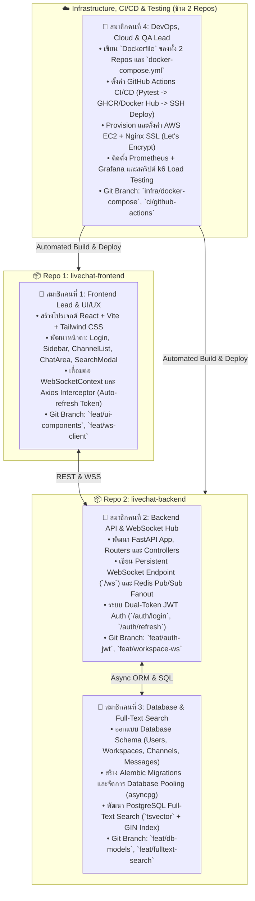

# Actionable Project Build Roadmap: Real-Time Live Chat Platform
> **Target Deadline:** ก่อนวันศุกร์ที่ 24  
> **Repository Strategy:** 2 Repositories แยกกัน (`livechat-backend` & `livechat-frontend`)  
> **Team Size:** 4 คน (ทุกคนต้องมีประวัติ Git Commit ในส่วนของตัวเอง)  
> **Deployment Target:** AWS EC2 + Docker Compose + Nginx (HTTPS)

---

## 1. การแบ่งบทบาทหน้าที่ 4 คนในทีม (Team Accountability)

อาจารย์เน้นย้ำว่า **"ทุกคนต้องมี Git Commit ยืนยันการลงมือจริง"** ดังนั้นจึงแบ่งหน้าที่ตาม 4 เสาหลักอย่างเด็ดขาด:

---

## 2. แผนการพัฒนารายสปรินต์ (Sprint Timeline จนถึงวันนำเสนอ)

### 🗓️ Phase 1: Repo Setup & Core Foundations (วันที่ 1 - 2)
* **คนที่ 4 (DevOps):**
  * สร้าง 2 Repositories บน GitHub: `livechat-backend` และ `livechat-frontend`
  * เพิ่มเพื่อนทั้ง 3 คนเป็น Collaborators
  * ร่างไฟล์ `docker-compose.yml` สำหรับรัน Postgres 15 และ Redis 7 ในเครื่อง
* **คนที่ 3 (DB):**
  * วางโครงสร้าง SQLAlchemy 2.0 Async Models (User, Workspace, Channel, Message, MessageRead)
  * ตั้งค่า Alembic และรัน Migration ครั้งแรก
* **คนที่ 2 (Backend):**
  * วางโครงสร้าง FastAPI (`app/main.py`, Settings, CORS, Auth Router)
  * ทำ Dual-Token JWT (Access Token 30m / Refresh Token 7d)
* **คนที่ 1 (Frontend):**
  * สร้างโปรเจกต์ Vite + React + TypeScript + Tailwind CSS
  * วางโครงสร้าง Routing (หน้า Login, Register, Chat Dashboard)

---

### 🗓️ Phase 2: Real-time Messaging & Search Engine (วันที่ 3 - 4)
* **คนที่ 2 (Backend):**
  * สร้าง `/ws` (Workspace-level WebSocket Hub)
  * เชื่อมต่อ Redis Pub/Sub Broadcast Engine เมื่อมีข้อความเข้า
  * จัดการ Heartbeat Presence (Online/Offline status TTL 60s)
* **คนที่ 3 (DB):**
  * เพิ่มคอลัมน์ `search_vector tsvector` ลงในตาราง `messages`
  * สร้าง GIN Index และ Trigger อัปเดต Search Vector อัตโนมัติ
  * ทำ Endpoint ค้นหาข้อความย้อนหลังด้วย `ts_rank`
* **คนที่ 1 (Frontend):**
  * พัฒนา `WebSocketContext` เชื่อมต่อ `/ws` และรับส่งข้อความสด
  * ทำ UI Typing Indicator, สัญลักษณ์สถานะ Online จุดเขียว และ Search Modal
  * ทำ Axios Interceptor ดักจับ Token หมดอายุและ Refresh อัตโนมัติ

---

### 🗓️ Phase 3: Containerization & Cloud Deployment on AWS (วันที่ 5 - 6)
* **คนที่ 4 (DevOps):**
  * เขียน `Dockerfile` สำหรับ Backend (Python 3.11) และ Frontend (Nginx Multi-stage build)
  * สร้าง AWS EC2 Instance (Ubuntu 22.04 LTS / t3.small หรือ t3.medium)
  * ตั้งค่า Security Group (พอร์ต 80, 443, 22)
  * รัน Docker Compose บน EC2 พร้อมตั้งค่า Nginx Reverse Proxy และ SSL ด้วย Certbot
  * ทำ GitHub Actions Deploy Workflow (เมื่อมีคน Merge PR เข้า `main` -> SSH ไปสั่ง Docker Compose อัปเดตบน EC2 อัตโนมัติ)
* **ทั้งทีม:**
  * รวมทดสอบระบบแบบ End-to-End บน URL จริงของ AWS EC2

---

### 🗓️ Phase 4: Load Testing, Observability & Verification (วันที่ 7)
* **คนที่ 4 & คนที่ 2:**
  * รัน Prometheus และ Grafana Dashboard บน EC2 เพื่อดู Active WS และ Latency
  * ยิงสคริปต์ k6 (`ws_stress_test.js`) ทดสอบ Concurrency และแคปภาพสถิติเก็บไว้ใช้ในสไลด์
* **คนที่ 1 & คนที่ 3:**
  * เช็กความเรียบร้อยของ UI/UX และระบบค้นหาข้อความ
  * ตรวจสอบว่าทุกคนมีประวัติ Commit บน GitHub ครบทุกคนตามที่อาจารย์สั่ง

---

## 3. Git Branching & Pull Request Rules (เพื่อคะแนน Git Commit)
1. **ห้าม Commit ลง branch `main` โดยตรง:** ทุกคนต้องสร้าง Branch ของตัวเอง เช่น:
   * `feat/user-auth-jwt` (โดย คนที่ 2)
   * `feat/message-search-tsvector` (โดย คนที่ 3)
   * `feat/chat-dashboard-ui` (โดย คนที่ 1)
   * `infra/ec2-docker-compose` (โดย คนที่ 4)
2. **สร้าง Pull Request (PR):** เมื่อทำฟีเจอร์เสร็จ ให้เปิด PR ขอ Review จากเพื่อนในทีมก่อนกด Merge
3. **ผลลัพธ์:** เมื่ออาจารย์เปิดดูหน้า Insights > Contributors บน GitHub จะเห็นกราฟ Commit และ PR ของสมาชิกทั้ง 4 คนอย่างชัดเจน 100%
